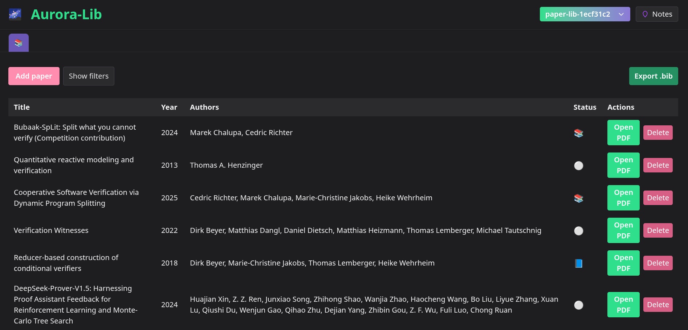
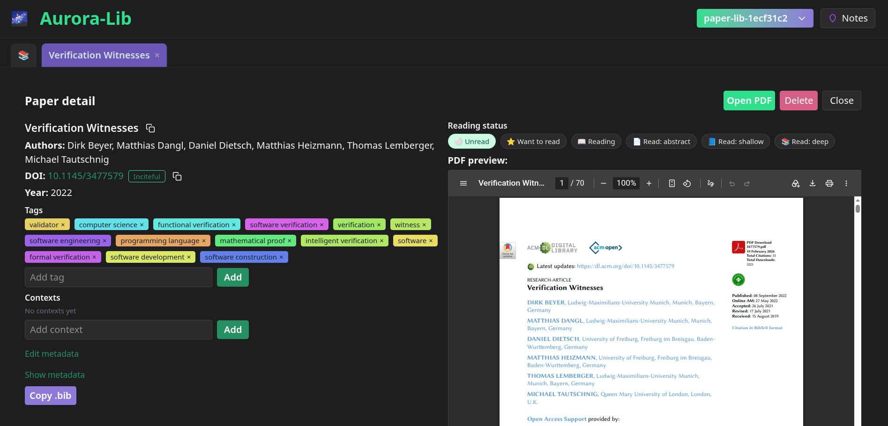
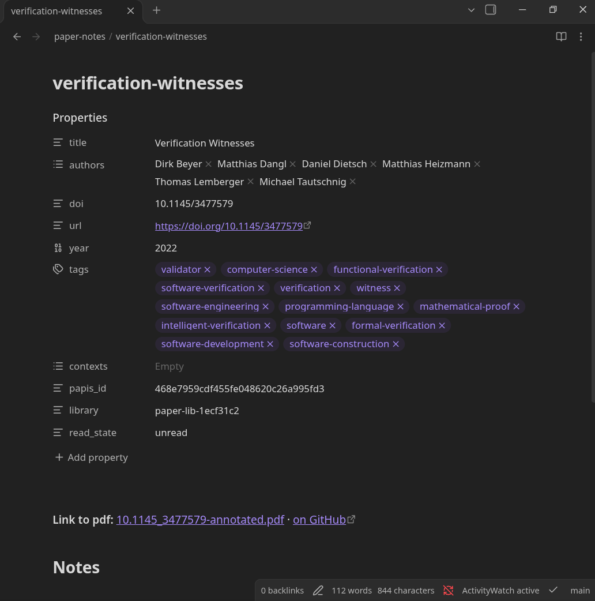
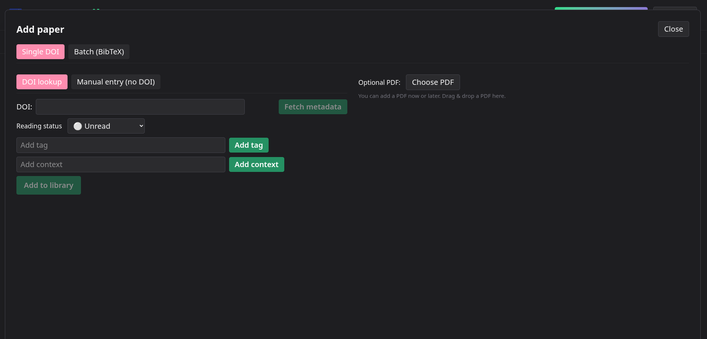

> **Disclaimer:** While I spent quite a bit of time on making and using this project already, much of the codebase was developed with the help of AI agents. It is also a pet project that I made focusing mostly on my own needs. I hope others can benefit from Aurora Lib as well: feel free to use it, fork it, leave issues, but please take the above into account.

Aurora Lib is a local-first web UI for managing a papis library inside an Obsidian vault.



## Main features

- **Library management**
    - Manage papers from a browser UI backed by papis.
    - Add papers with minimal work via DOI (single) or BibTeX (batch), with (optional) PDF upload.
    - Edit metadata in-app (title/authors/year/DOI) and attach or replace PDFs.
    - Batch-select papers and export BibTeX for selected entries.
- **Discovery and organization**
    - DOI metadata resolution with Crossref + DataCite fallback.
    - Automatic OpenAlex keyword/tag enrichment (editable).
    - Quick link-out to Inciteful from paper detail views.
    - Read-state tracking, tags, contexts/projects, advanced filtering, and column sorting.
- **Obsidian workflow**
    - Obsidian note integration with synchronized paper metadata and PDF links.
    - Multiple paper detail tabs and restored UI state between sessions.
- **File-based by design**
    - Works directly on files in your vault (no separate database service).
    - papis metadata is stored as YAML (for example `info.yaml`) alongside document files.
    - Notes are standard Markdown files.
    - Portable, readable, and version-control friendly.

### Screenshots

The paper detail view, with tags, reading status and a PDF preview:



The Obsidian note that Aurora Lib generates for the same paper. Aurora Lib keeps the properties and the PDF link up to date, and leaves everything under `## Notes` alone:



Adding a paper by DOI, with an optional PDF:



### Obsidian recommendations

- If you are new to Obsidian, this getting-started guide is a good overview: [Getting started with Obsidian](https://obsidian.rocks/getting-started-with-obsidian-a-beginners-guide/).
- For syncing a vault with Git (including Android workflows), the Obsidian Git plugin is recommended. 
    - Practical mobile notes: [Obsidian Android syncing via GitHub](https://www.reddit.com/r/ObsidianMD/comments/17odzjb/obsidian_android_syncing_via_github_in_2023/).
- For reading and annotating PDFs inside Obsidian, PDF++ is recommended.

## Requirements

The Linux user service and development need Python 3.14 and Node.js 24. These are the only tested versions. The Docker image brings its own.

## Install options

Both options start from a clone of this repo, together with the papis submodule:

```
git clone --recursive https://github.com/AdamZsofi/aurora-lib.git
cd aurora-lib
```

If you cloned without `--recursive`, the install scripts fetch the submodule for you.

### Linux user service (recommended)

The service runs from this repo checkout, so keep the checkout in place after you install. A standalone release is not available yet.

See [packaging/README.md](packaging/README.md) and run:

```
./packaging/install.sh
```

### Docker

Start:

```
./packaging/docker/start.sh /absolute/path/to/vault
```

Stop:

```
./packaging/docker/stop.sh
```

Notes for Docker mode:
- Single-vault mode is enforced.
- Server-side “Open PDF” is disabled in Docker mode.

## Architecture

- FastAPI + Uvicorn backend exposes paper/library/metadata/note endpoints.
- React + TypeScript UI consumes backend APIs.
- Data is stored in papis document folders inside the selected vault.

## Metadata sources

- Primary DOI resolution: Crossref (via papis).
- Fallback DOI resolution: DataCite.
- Keyword/tag enrichment: OpenAlex.

OpenAlex tags are best-effort and can be edited manually in the UI.

## Quickstart for development

### Backend

The `papis/` submodule must be present. `requirements.txt` installs it as an editable dependency.

```
git submodule update --init
./scripts/ensure-venv.sh
source .venv/bin/activate
(cd service && pip install -r requirements.txt)
uvicorn service.main:app --reload --port 8000
```

The backend must run on port 8000 in dev. The Vite dev server proxies `/api` to that port.

### Frontend (optional in dev)

If you want Vite hot reload for frontend work:

```
cd web-ui
npm install
npm run dev
```

### Tests

Run the tests in a container with podman or docker. The container mounts the repo read-only and has no network access:

```
scripts/test.sh
```

To run them directly, for example to debug one test:

```
pip install -r requirements-dev.txt
python -m pytest -k <test name>
```

## License

Copyright (C) 2026 Zsófia Ádám.

Aurora Lib is free software. You can redistribute it and modify it under the terms of the GNU General Public License, version 3 or later. See [LICENSE](LICENSE) for the full text.

Aurora Lib depends on [papis](https://github.com/papis/papis) (GPL-3.0), included as a submodule. That dependency is the reason this project uses GPL-3.0.
